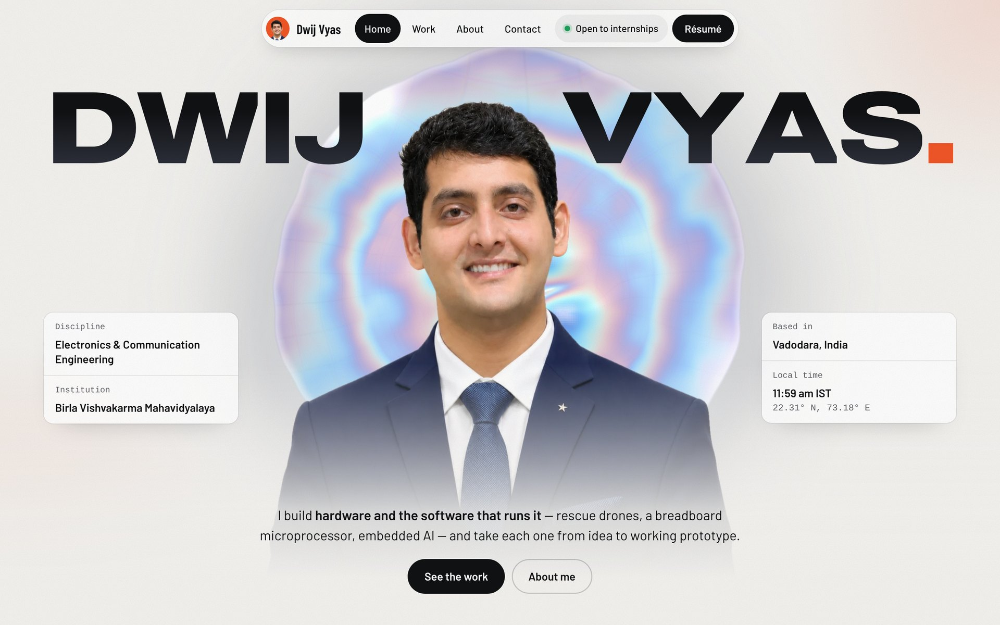

# Dwij Vyas — Portfolio

**Live:** https://dwijvyasportfolio.vercel.app

[](https://dwijvyasportfolio.vercel.app)

Portfolio of Dwij Vyas, Electronics & Communication Engineering undergraduate at Birla Vishvakarma Mahavidyalaya. It covers hardware and the software that runs it: rescue drones, a breadboard 4-bit microprocessor, embedded AI, and the AERONEX ground station.

The site is plain HTML, CSS and JavaScript with no build step and no framework. All content comes from one file, `content.json`, and a browser-based editor at `/admin` updates that file through the GitHub API.

---

## Pages

| Route | File | What it is |
|---|---|---|
| `/` | `index.html` | Home: hero, key figures, introduction, a working AM/FM/PSK modulator you can listen to, the AVION airframe annotated part by part, footage, a film strip of project photographs, selected work |
| `/work` | `work.html` | Every project, as a numbered list or a grid, filterable by discipline |
| `/project?p=<id>` | `project.html` | One case study: overview, specifications, optional chapters, gallery, next project |
| `/about` | `about.html` | Education, timeline, skills |
| `/resume` | `resume.html` | Online résumé built from `content.json`, printable, with the PDF |
| `/admin` | `admin.html` | Content editor (not indexed by search engines) |
| — | `404.html` | Not-found page |

## Repository layout

```
.
├── index.html, work.html, about.html, project.html, resume.html, 404.html
├── admin.html              content editor
├── content.json            all content: profile, contact, education, milestones, projects, skills
├── vercel.json             clean URLs, security headers, caching rules
├── assets/
│   ├── site.css            the design system
│   ├── site.js             shared behaviour: content loading, header, contact, lists, cursor, sound, shortcuts
│   ├── blob.js             hero glass shader (WebGL)
│   ├── scope.js            modulator: oscilloscope and audio
│   ├── drone.js            AVION airframe scene (three.js)
│   ├── system.js           chapter stepping and part callouts for the airframe
│   ├── aeronex.glb         airframe model
│   ├── img/                project photographs (WebP, max 1280 px wide)
│   │   └── thumb/          720 px versions for lists, the film strip and hover previews
│   ├── video/              background footage
│   └── favicon-32.png, favicon-192.png, apple-touch-icon.png, avatar.webp, portrait-hero.webp
├── fonts/                  self-hosted WOFF2 fonts and their licence (OFL.txt)
├── vendor/                 three.js and Lenis, with their licences
├── tools/build_resume.py   builds Dwij_Vyas_Resume.pdf from content.json (fonts in tools/fonts)
├── docs/home.jpg           screenshot used in this README
├── Dwij_Vyas_Resume.pdf, og-image.jpg, favicon.ico, robots.txt, sitemap.xml
├── CLAUDE.md               working notes for AI coding agents
├── CREDITS.md              third-party software, fonts and footage
└── .vercelignore           keeps docs, tools and these notes out of the deployed site
```

## Run it locally

```bash
python3 -m http.server 8000
# open http://localhost:8000
```

Any static server works. Opening the files directly with `file://` does not, because the pages fetch `content.json`.

## Editing content

**From the browser.** Open `/admin` on the live site and sign in. In Settings, paste a fine-grained GitHub token that has access to this repository only, with **Contents: Read and write**. By default the token is kept only until the tab closes. **Publish to live site** commits `content.json` (and any new images, as WebP files under `assets/img/` with a small copy under `assets/img/thumb/`) to `main`; Vercel redeploys in about a minute.

In the editor you can:
- edit the profile, contact links, education, recognition and skills;
- add, reorder and remove projects, with images, specifications and links;
- write a case study as **chapters** (title, paragraph, optional image);
- choose the **featured project**, shown large at the top of Selected work on the home page.

**By hand.** Edit `content.json` with a script rather than a text editor (Python `json` load, change, dump with `ensure_ascii=False` and a 2-space indent), and match the shape of existing entries. Pull first: the editor also commits this file.

**Résumé PDF.** After changing content, rebuild the PDF:

```bash
pip install reportlab
python3 tools/build_resume.py
```

## Deployment

Vercel project `dwijvyasportfolio`, connected to this repository with no framework preset and no build command. Every push to `main` goes to production; every other branch gets a preview URL. `vercel.json` sets clean URLs, security headers, `no-cache` on `content.json` and `noindex` on the editor.

## Accessibility and performance

- Every animation has a still alternative under `prefers-reduced-motion`.
- `content.json` (about 16 KB) is requested while the HTML is still parsing, so text appears within the first second.
- Lists, the film strip and hover previews use 720 px thumbnails; images further down the page are fetched in the background once the first screen has settled, so they are already there when you scroll to them.
- The 3D engine and airframe model download at low priority from the start and are compiled before the section is reached.
- WebGL scenes pause when off-screen and step down in quality, then to a still frame, on slow devices.
- Fonts, libraries, images and video are served with long cache lifetimes; the next page is prefetched when a link is hovered.
- Keyboard: `H` home, `W` work, `A` about, `C` contact, `R` résumé, `?` for the list.

## Credits

Third-party code, fonts and footage are listed with their licences in [CREDITS.md](CREDITS.md).

All other content (text, photographs, project material and the airframe model) © Dwij Vyas. All rights reserved.
